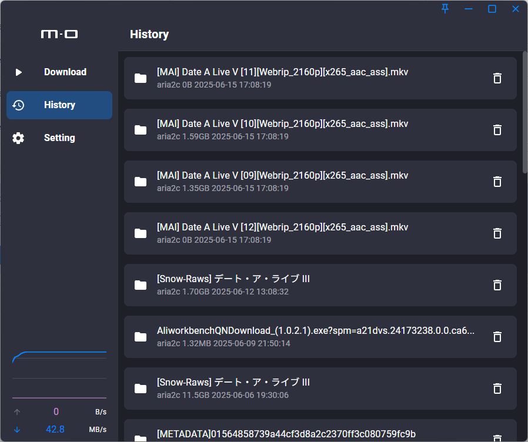
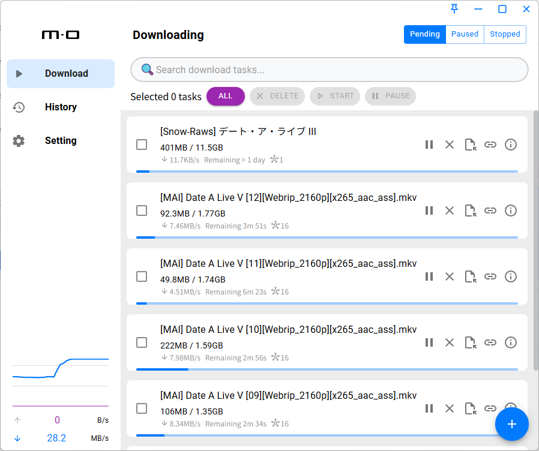

# tauri-motrix

[](https://github.com/taoister39/tauri-motrix/issues?q=is%3Aopen+is%3Aissue+label%3Afeature-request+sort%3Areactions-%2B1-desc)
[](https://github.com/taoister39/tauri-motrix/issues?utf8=✓&q=is%3Aissue+is%3Aopen+label%3Abug)

Tauri Motrix is a full-featured download manager written in Tauri.The purpose is to restructure [Motrix](https://github.com/agalwood/Motrix) open source project.

## Preview

| Dark                             | Light                             |
| -------------------------------- | --------------------------------- |
|  |  |

## Install

Go to the [release page](https://github.com/Taoister39/tauri-motrix/releases) to download the corresponding installation package
Supports Windows, macOS, and Linux, with x64 and ARM64 builds on all three platforms. Choose an EXE installer for Windows, a DMG for Intel or Apple Silicon Macs, or a DEB or AppImage for Linux.

## Features

- 🎨 Material Design Theme (MUI).
- 🚀 Supports 128 threads in a single task
- 📦 Lightweight, small package size
- 🚥 Supports speed limit
- 🔌 Configurable aria2 RPC port and secret for third-party download tools
- 🖥️ Optional minimize to tray on auto launch, configurable in Settings → Display (off by default). Manual launches still show the window.
- Native tray shortcuts for new downloads, torrent files, all-task controls, navigation, settings, and updates.

Tray task controls run in the background across aria2 and Vortex. Pause All includes queued tasks and BitTorrent seeding; Resume All resumes every paused task, including manually paused tasks, without retrying failed tasks. Tasks awaiting file deletion confirmation are skipped and reported. Opening a torrent from the tray always previews it before submission.

## Global shortcuts

Open **Settings → Global shortcuts** to assign or clear shortcuts for showing Motrix and opening a new download. Both are unbound by default. Use Ctrl, Alt, or Command/Super with a letter, digit, or F1–F24; Shift is optional. Changes take effect immediately while Motrix is running, including in the system tray. Registration failures appear in Settings and retain the previous binding.

The new-download shortcut fills a single HTTP, HTTPS, FTP, or magnet link from the clipboard and waits for confirmation. Repeating it preserves an open form and any selected torrent. Global shortcuts support Windows, macOS, and Linux X11; Wayland is not supported.

## RPC downloads

Open **Settings → Aria2 Engine → RPC Settings** to change the RPC port (1024–65535) and optional secret. Copy the RPC address into your browser extension or cloud-drive download tool, and use the same secret there. The default address is `http://127.0.0.1:16801/jsonrpc`.

Saving restarts the built-in aria2 engine and restores its saved task session. If the new port is occupied or the restart fails, the previous settings are retained. Clearing the secret disables RPC authentication.

## Removing tasks and files

Removing a task opens a confirmation dialog. Files are kept by default, including unfinished download data. Select **Also delete downloaded files** to move task files to the system Recycle Bin or Trash. This also applies to multiple selected tasks and preserves download history.

If recycling fails, a second dialog lists file outcomes and asks whether to permanently delete the remaining files. Permanent deletion requires explicit confirmation. Canceling keeps failed tasks stopped; files already recycled are not automatically restored. Successful tasks are removed independently. Only task files and their download control files are processed; unrelated files in the same folder are retained.

Task removal always requires confirmation. Existing `no_confirm_before_delete_task` configuration values remain compatible but no longer bypass the dialog. This affects the built-in aria2 and Vortex engines; external RPC clients can still control aria2 independently.

## Download history

History shows file content thumbnails when the operating system can provide them, then falls back to the system file icon, including embedded executable icons on Windows. Application placeholders are used only when neither is available. Windows uses Shell images, and macOS uses Quick Look with Finder icons as a fallback. Linux reuses the standard thumbnail cache and installed thumbnailers, with GdkPixbuf for images and the desktop icon theme as a fallback; video and document previews depend on installed providers.

Missing local files have struck-through names and a disabled file-location button. Availability refreshes when opening history or returning to the window. Each item has direct buttons to locate the file, copy its download link, and delete only the history record. Removing a history record does not delete its files.

## Development

To run the development server, execute the following commands after all prerequisites for Tauri are installed:

> [!NOTE]
>
> **If you are using a Windows ARM or Linux ARM device, you need to install [LLVM](https://github.com/llvm/llvm-project/releases) (including clang) and set the environment variable.**
>
> This is because the `ring` crate is compiled using `clang` on Windows ARM and Linux ARM platforms.
> See this [PR](https://github.com/briansmith/ring/pull/2216) for the ongoing work to replace cl.exe with clang-cl.

```Powershell
pnpm i
pnpm check
pnpm tauri dev
```

After editing `src/locales/*.json`, run `pnpm prepare:locales` to refresh native translations without downloading aria2 again. `pnpm check` still prepares both the sidecar and translations.

## Contributions

Issue and PR welcome!

## Acknowledgements

Thanks to the following projects for giving me inspiration and reference:

- [Clash Verge](https://github.com/clash-verge-rev)
- [Motrix](https://github.com/agalwood/Motrix)
- [aria2](https://github.com/aria2/aria2)
- [antd](https://github.com/ant-design/ant-design)
- [rc-util](https://github.com/react-component/util)
- [stylex-swc-plugin](https://github.com/Dwlad90/stylex-swc-plugin)

## License

GPL-3.0 License. See [License here](./LICENSE) for details.
