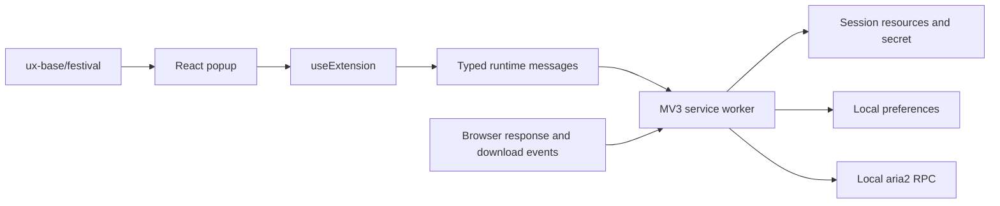

# Motrix Companion

A Manifest V3 browser extension with the Motrix Orbit festival UI. Built with React, MUI 9.5, Addfox, and the opt-in `@tauri-motrix/ux-base/festival` entry.

## Run

From the repository root:

```sh
pnpm --filter @tauri-motrix/ux-base build
pnpm --filter @tauri-motrix/extensions build
```

Load `apps/extensions/.addfox/extension/extension-chromium` using **Load unpacked** in Chrome or Edge's extension manager. Addfox also produces `apps/extensions/.addfox/extension/extension-chromium.zip`. Use `pnpm --filter @tauri-motrix/extensions build:edge` to select Edge; both browsers share the Chromium output directory. Production commands use `--no-open` so they work in CI without an installed browser. The former `unpacked` directory is no longer updated.

Open Motrix, then enter the RPC port and secret in the companion's settings. The default port is **16801**, matching the desktop configuration. Secrets are kept only for the browser session; preferences survive browser restarts.

An unpacked extension's ID can change when its directory changes. To upgrade an existing installation while retaining local preferences, extract the generated ZIP into its already-registered extension directory and select **Reload**, keeping that registration. Loading the new Addfox directory as a separate extension does not migrate browser storage. The storage schema and runtime message protocol remain compatible.

For development, run `pnpm --filter @tauri-motrix/extensions dev` or `dev:edge`. Addfox launches the selected browser with the extension loaded, writes development files to the same output directory, and manages extension reloads and popup HMR. Its temporary browser profile is separate from your regular profile. Pass `--keep-browser-profile` to retain that development profile between runs, or `--no-open` to load the output manually in a browser of your choice. Run only one Chrome/Edge development session at a time because they share the output and reload ports.

The UI-only preview is available at `http://localhost:2542/popup/index.html` while development is running. Browser-only preview explicitly disables native extension actions and contains no fabricated discoveries. Port 2542 is strict to keep the preview address predictable and separate from the desktop frontend. Reload the unpacked extension after a production rebuild to update its worker. Run a production build before distributing or archiving the output: development files include reload support and development-only permissions.

The action popup uses a 420 × 600 CSS pixel layout. Viewport limits and wide-screen decoration apply only to the `browser-preview` context. Do not constrain the action popup with `vh`, `dvh`, or `vw`: browsers size the popup viewport from its content, creating circular sizing constraints. If the popup appears as a thin strip, rebuild, reload the extension in the browser's extension manager, then close and reopen the popup.

## Build configuration

`addfox.config.ts` sets `appDir: "src"` and explicitly declares `popup.tsx` with HTML enabled and `background.ts` as script-only. Addfox emits popup HTML only for the UI and injects generated entry paths into the manifest loaded from `src/manifest.json`. Explicit entries preserve the flat source layout without relying on HTML-based discovery conventions. Keep permissions and metadata in that source manifest; do not copy a second manifest through `public/` or edit the generated one.

Files in `public/` are copied to the extension root, preserving root-relative `/assets/` URLs for the hero artwork. Font imports and shared styles are bundled from the popup entry. Runtime messages, RPC, storage, hooks, and shared presentation components retain their existing boundaries; Addfox introduces no runtime API dependency.

The workspace catalog pins Addfox 0.2.9. Its Rsbuild 2.2.1 peer is isolated in `catalog:addfox`, so the desktop and shared-library build versions are unaffected. Addfox uses Rsbuild internally; the extension's commands and entry/manifest lifecycle are managed by Addfox. See the official [installation guide](https://addfox.dev/guide/install) and [manifest guide](https://addfox.dev/config/manifest).

## Behavior

- **Download takeover:** opt in to website access; ordinary HTTP(S) downloads are paused, submitted to the local aria2 RPC service, then cancelled in the browser only after a valid task ID is returned. A rejected handoff attempts to resume the browser download. A timeout may mean aria2 accepted the task but the reply was lost; check Motrix before retrying. Blob URLs, other extensions' downloads, and downloads that cannot be paused are left alone.
- **Resource radar:** opt in to website access and listen to response headers. Discovers video, audio, images, files, and HLS/DASH manifests. Only the current tab's resources are shown. Existing page requests must be reissued by reloading or playing media. Cached requests, protected browser pages, and some embedded media may not be observable.
- **Resource lifetime:** at most 200 unique URLs per tab, stored in browser session storage; cleared on tab navigation or closure. Pausing discovery retains the current list. Clearing a list never deletes desktop tasks.
- **Sending:** direct HTTP(S) resources are sent individually; confirmed tasks are marked sent and not submitted again from the same list. Partial failures retain failed selections. Streaming manifests are identified but not treated as complete playable files; stream assembly and authenticated-media support are not implemented here.
- **Connection:** localhost only, using `aria2.getVersion` and `aria2.addUri`. This does not route tasks to Vortex. No cookies, Authorization headers, or browsing history are collected. Signed-in media can require additional desktop support.
- **Appearance:** light, dark, and live system theme. Search, category filters, batch selection, resource details, clear confirmation, error notifications, and keyboard-accessible MUI controls.

## Architecture



Shared components contain no extension APIs, persistence, RPC calls, or application state. The existing StyleX entry points remain unchanged. MUI is an optional peer dependency of ux-base; consumers of the festival entry install it explicitly.

## Validation

Run the root build before focused tests:

```sh
pnpm build
pnpm --filter @tauri-motrix/extensions build
pnpm test --selectProjects common-platform --runInBand --runTestsByPath tests/extension.test.ts tests/extension-hook.test.tsx tests/extension-popup.test.tsx
node --test scripts/extension-build.test.mjs
pnpm --filter @tauri-motrix/ux-base typecheck
pnpm --filter @tauri-motrix/extensions typecheck
```

The unit tests cover resource classification, message validation, safe download handoff, hook refresh/permission/send behavior, and isolation of preview-only popup constraints. The build contract tests require production output and check generated manifest permissions, popup assets, worker startup without a DOM, and ZIP contents. Run them after either Chrome or Edge production builds; development output deliberately fails the production contract.

Check the popup at 320px, 390px, 420px, tablet, and desktop viewport widths, including settings, keyboard focus, and light/dark/system themes. The compact layout, original courier artwork, poster typography, and shared festival tokens are retained during the build migration.

See `public/assets/README.md` for artwork and font attribution. Shared component examples are under Storybook's **Festival / Companion components**.
